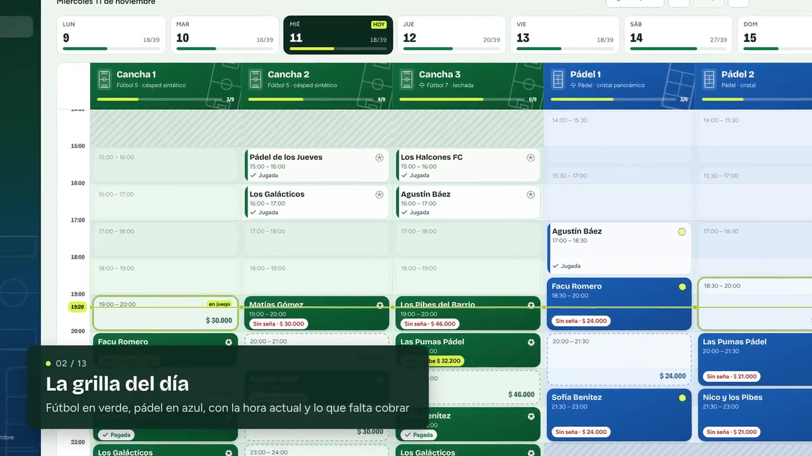

# Canchas

Sistema de reservas para complejos de fútbol y pádel: reservas por cancha, señas y cobros, abonos fijos, avisos por WhatsApp, comprobante impreso, reportes y torneos. Es una aplicación de escritorio que funciona sin internet.



[Ver el video de la demo en mi portafolio](https://sergio-cardozo.vercel.app/#p-canchas)

## Qué hace

- Grilla del día con una columna por cancha, la línea de la hora actual y el estado de cada reserva. No deja superponer turnos.
- Seña y saldo con efectivo, transferencia, Mercado Pago o tarjeta, con precios por cancha y franja horaria.
- Abonos: los equipos que juegan todas las semanas se reservan solos. Bloqueos de canchas por lluvia, mantenimiento o torneos.
- Mensajes de WhatsApp armados para recordatorios, cobro del saldo o confirmación.
- Comprobante de 72 mm para impresora térmica.
- Reportes de ingresos, medios de pago y ocupación, mapa de calor de horarios, mejores clientes y deudores.
- Torneos: inscripción cobrada, fixture todos contra todos, carga de resultados y tabla de posiciones automática.
- Ingreso con PIN, roles de administrador y encargado, copias de seguridad e historial de quién hizo cada cosa.

## Aspectos técnicos

- **Procesos separados y permisos por canal:** Electron dividido en main, preload y renderer, con un contrato tipado de IPC y permisos por canal (libre, sesión o administrador).
- **Reglas protegidas dos veces:** en el código y con triggers SQL que impiden superponer turnos.
- **Todo auditable:** dinero en centavos y bajas lógicas, así nada se borra. PIN con scrypt y copias con la API nativa de SQLite.

## Tecnologías

Electron · Electron Forge · Vite · React 19 · TypeScript · Tailwind CSS 4 · shadcn/ui · TanStack Query · Zod · SQLite con Drizzle · Vitest

## Cómo ejecutarlo

Necesitás [Node.js](https://nodejs.org) en su versión LTS.

```bash
npm install
npm start          # abre la aplicación en modo desarrollo
npm test           # corre las pruebas automatizadas
npm run typecheck  # revisa los tipos de TypeScript
npm run make       # genera el instalador (en Windows, el .exe)
```

La primera vez que se abre, el sistema pide crear el primer usuario con su PIN.

## Estructura

```
src/
  main/        proceso principal de Electron: base de datos, servicios y canales IPC
  preload/     puente seguro entre la ventana y el proceso principal
  renderer/    interfaz en React
  compartido/  tipos, esquemas de Zod y cálculos que usan los dos lados
pruebas/       pruebas automatizadas con Vitest
```

## Autor

**Sergio Cardozo**, desarrollador full stack en Formosa, Argentina.
[Portafolio](https://sergio-cardozo.vercel.app) · [LinkedIn](https://www.linkedin.com/in/sergiocardozo-dev) · [GitHub](https://github.com/Gabicrdz)
